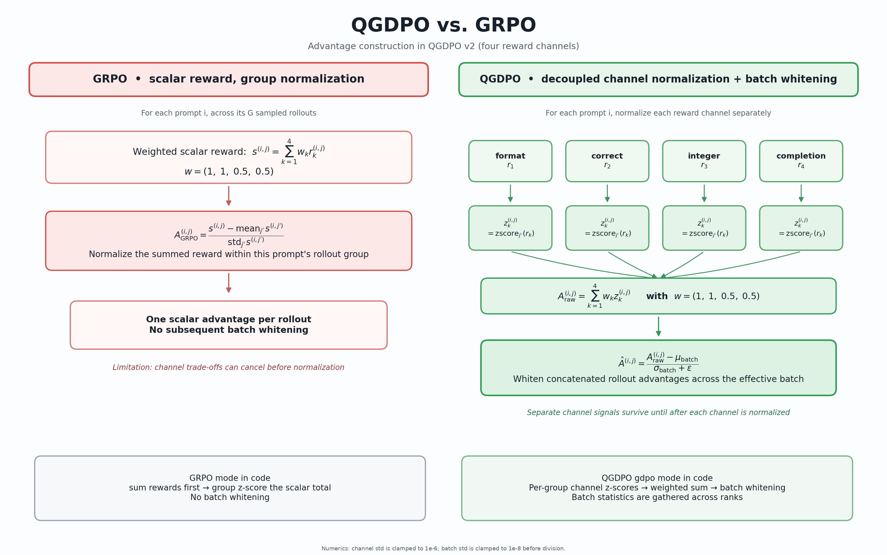
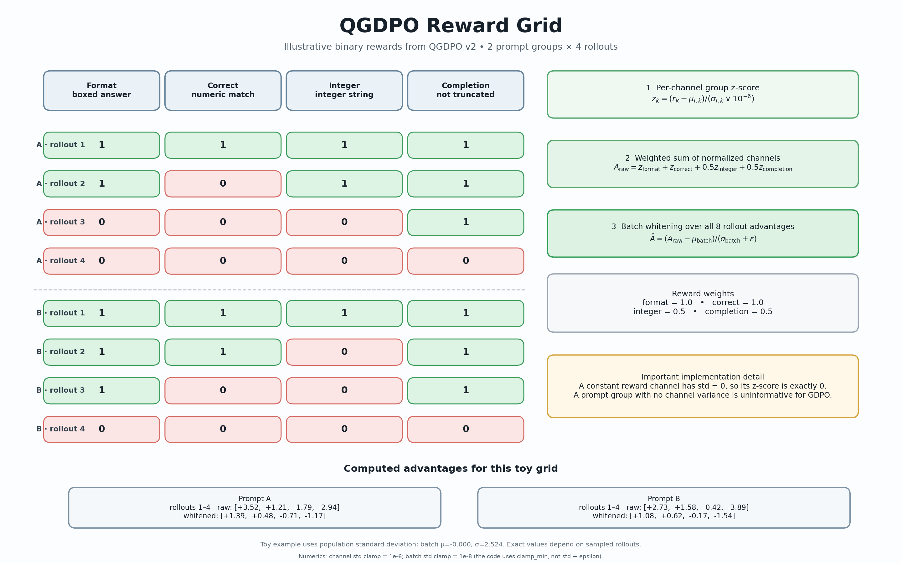

# QGDPO

<p align="center">
  <strong>Quantized Group reward-Decoupled Normalization Policy Optimization</strong><br>
  <em>Memory-efficient multi-reward policy optimization for a single 16 GB NVIDIA T4 GPU.</em>
</p>

<p align="center">
  
  
  
  
</p>

## How QGDPO works



## Reward design



QGDPO is an experimental, lightweight implementation of [GDPO](https://github.com/NVlabs/GDPO), adapted to run on a single NVIDIA T4 GPU (16 GB VRAM). It combines 4-bit NF4 quantization, QLoRA, and multi-channel reward normalization to make reinforcement-learning fine-tuning practical on constrained hardware.

---

## At a glance

| Component | Configuration |
|---|---|
| Base model | Qwen2.5-1.5B-Instruct |
| Optimization | GDPO (with a GRPO baseline) |
| Quantization | 4-bit NF4 |
| Fine-tuning | QLoRA |
| Target GPU | NVIDIA T4 |
| GPU memory | 16 GB |

---

## How QGDPO works

The diagrams below visualize the main stages of QGDPO:

1. Generate multiple responses per prompt
2. Evaluate them with independent reward channels
3. Normalize each reward separately
4. Combine the normalized signals
5. Update the policy with memory-efficient QLoRA fine-tuning

### GDPO: why decouple rewards?

In standard GRPO, multiple reward signals are typically combined into a single scalar *before* advantage normalization. When reward channels have different scales or distributions, one signal can dominate the others.

GDPO instead:

- normalizes **each reward channel independently**,
- combines the normalized signals using configurable weights,
- and whitens the resulting advantages across the training batch.

---

## Reward design

QGDPO uses four independent reward channels:

| Reward | What it checks |
|---|---|
| Format | The answer uses the required `\boxed{}` format. |
| Correctness | The numerical answer matches the expected result. |
| Integer | The answer is an integer. |
| Completion | The response finishes without being truncated. |

Default reward weights: **(1.0, 1.0, 0.5, 0.5)**, respectively.

---

## Installation

```bash
git clone https://github.com/Neuille-hush/QGDPO.git
cd QGDPO
pip install -r requirements.txt
```

---

## Usage

**Start training:**

```bash
accelerate launch train.py
```

**Run a quick smoke test:**

```bash
accelerate launch train.py --smoke
```

**Run the GRPO baseline:**

```bash
accelerate launch train.py --mode grpo
```

**Run the self-tests:**

```bash
python train.py --selftest
```

---

## Notes and limitations

QGDPO is an **experimental** implementation. Training behavior and results depend on the model, dataset, reward definitions, hyperparameters, and available hardware. The NVIDIA T4 target describes the intended memory-constrained setup; actual runtime and achievable batch sizes will vary.

---

## Acknowledgements

This project is based on [NVIDIA's GDPO implementation](https://github.com/NVlabs/GDPO) and the paper:

> Liu et al., *GDPO: Group reward-Decoupled Normalization Policy Optimization for Multi-reward RL Optimization* (2026). [arXiv:2601.05242](https://arxiv.org/abs/2601.05242)

---

## License

This project is licensed under the [Apache License 2.0](LICENSE).
