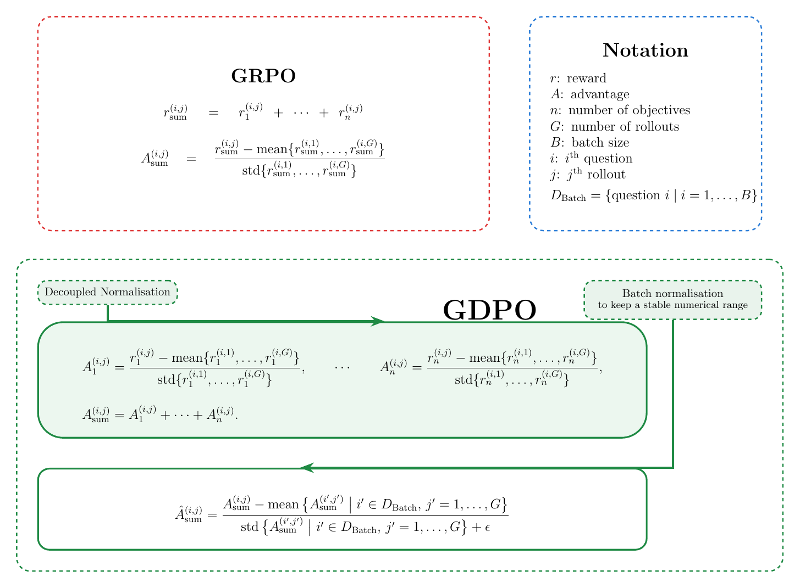
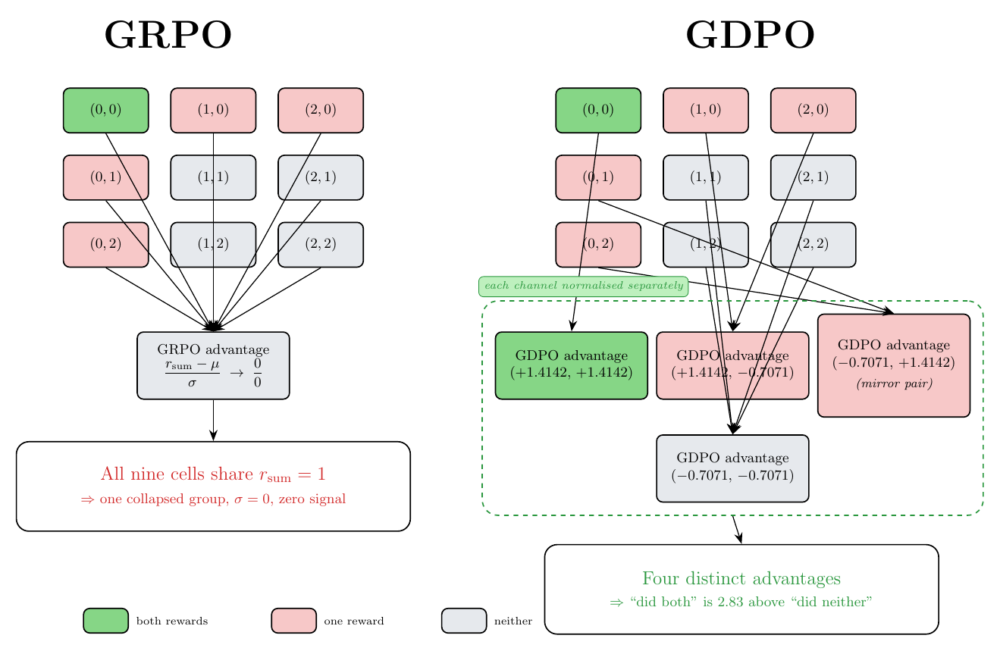

# QGDPO

**Quantized Group reward-Decoupled Normalization Policy Optimization**

QGDPO is an experimental implementation of GDPO (Group reward-Decoupled Normalization Policy Optimization) that combines 4-bit NF4 quantization and QLoRA to explore memory-efficient reinforcement learning for large language models.

The project is designed around the constraints of a single NVIDIA T4 GPU with 16 GB of VRAM.

---

## Overview

Reinforcement learning for language models is computationally demanding. Full-precision model weights, optimizer states, gradients, and generated sequences can quickly exceed the memory available on modest GPUs.

QGDPO explores a more accessible training setup by combining:

- **GDPO:** a GRPO-style policy optimization method for multi-reward RL.
- **4-bit NF4 quantization:** reduces base-model memory requirements.
- **QLoRA:** enables parameter-efficient fine-tuning.
- **T4-oriented configuration:** targets a single GPU with 16 GB of VRAM.

The objective is to investigate the practical feasibility of quantized GDPO training under constrained hardware budgets.

## Algorithm

### GDPO vs. GRPO

Group-based reinforcement learning (e.g. GRPO) samples multiple responses per prompt and scores each response relative to its group.

When several reward signals are combined, GRPO sums them into one scalar reward before normalizing. Rewards with larger scales or different distributions can then dominate, and distinct reward combinations can collapse into similar advantages.

GDPO instead normalizes each reward **separately** within the group, then combines the results. This decoupled normalization helps preserve the contribution of each individual objective.

GDPO is a policy optimization method, not Direct Preference Optimization (DPO). It does not use preference pairs.



[PDF version](docs/images/img.pdf)

### Reward Structure

The reward grid illustrates the structure of the reward components used in the algorithm.



[PDF version](docs/images/img2.pdf)

## Quantization and Fine-Tuning

| Component | Configuration |
|---|---|
| Base model precision | 4-bit |
| Quantization format | NF4 |
| Fine-tuning | QLoRA |
| Target GPU | NVIDIA T4 |
| Target GPU memory | 16 GB |

### NF4 Quantization

NormalFloat 4-bit (NF4) is a quantization format designed for normally distributed neural network weights. It provides a compact representation of model parameters and is commonly used in QLoRA-based fine-tuning.

### QLoRA

QLoRA keeps the base model quantized while training low-rank adapter parameters. This reduces memory requirements compared with full-parameter fine-tuning.

## Hardware

The primary target environment is:

- NVIDIA T4 GPU
- 16 GB VRAM
- CUDA-compatible PyTorch environment

Actual memory consumption depends on model size, sequence length, batch size, generation settings, and training configuration.

## Installation

Clone the repository:

```bash
git clone https://github.com/Neuille-hush/QGDPO.git
cd QGDPO
```

Install dependencies:

```bash
pip install -r requirements.txt
```

## Usage

The main training implementation is `train.py`.

```bash
python train.py
```

Configure the model, dataset, optimization parameters, and hardware settings in the training script.

On a 16 GB T4, monitor memory consumption and adjust batch size, sequence length, and generation settings as necessary.

## Repository Structure

```
QGDPO/
├── train.py
├── README.md
└── docs/
    └── images/
        ├── img.png
        ├── img.pdf
        ├── img2.png
        └── img2.pdf
```

## Project Goals

- Explore GDPO under constrained GPU memory.
- Investigate 4-bit NF4 quantization for reinforcement learning.
- Apply QLoRA for parameter-efficient model adaptation.
- Evaluate the practical trade-offs of quantized training on a single 16 GB GPU.

## Limitations

This project explores an implementation approach rather than claiming universal performance improvements.

Memory usage, convergence, and training performance depend on the selected model, dataset, hyperparameters, and hardware. Empirical evaluation is necessary to establish performance.

## Acknowledgements

Based on NVIDIA's GDPO work.

## References

- [NVIDIA GDPO](https://github.com/NVlabs/GDPO)
- [QLoRA: Efficient Finetuning of Quantized LLMs](https://arxiv.org/abs/2305.14314)
- [LoRA: Low-Rank Adaptation of Large Language Models](https://arxiv.org/abs/2106.09685)

## License

See the repository's `LICENSE` file for licensing information.
